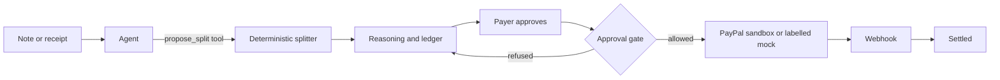

# Split Steward

Split Steward turns a shared-expense note into a settlement a person can check. An agent reads the note and calls one tool, `propose_split`. That tool runs a deterministic cent splitter and shows the reasoning. Each person who owes money approves their own charge. Only then does the app create a PayPal sandbox order or invoice. A webhook (or, in mock mode, a simulated webhook) moves the charge to settled.

This repository was written during the PayPal AI Hackathon submission window with AI coding assistance. See [AI_TOOLS.md](AI_TOOLS.md).

## What works right now

The path below is **mock mode**. It is what this environment can run, because PayPal sandbox credentials and an AI Gateway key are not configured here.

- Paste a note, or load one of the three samples.
- The heuristic parser (not a language model) extracts expenses. The page says so.
- The splitter computes balances and the fewest payments.
- Approving is refused unless you are the person who pays.
- “Create simulated PayPal order” writes an id that starts with `MOCK-` and opens an on-app checkout page. That page says it is not PayPal.
- “Simulate buyer approval” posts a mock webhook. The ledger says **Settled in simulation**.
- The other person’s charge stays proposed and has no PayPal id.

PayPal sandbox code is in the repo (`lib/paypal.ts`: OAuth, Orders v2, Invoicing v2, capture, webhook signature verification). It is covered by unit tests that stub `fetch` and assert the host is `https://api-m.sandbox.paypal.com`. Those tests do not prove a live sandbox call. Nothing in this build contacted PayPal.

## Demo

There is no hosted demo yet. Do not treat a mock recording as a PayPal demo.

Local mock walkthrough:

```bash
npm install
npm run dev
```

Open http://localhost:3000. The banner must say that PayPal was not called. Use **Cabin weekend**, approve as Noah, create the simulated order, and simulate the buyer.

The submission recording (Playwright + ffmpeg, under 3 minutes) is [scripts/DEMO.md](scripts/DEMO.md). Run it after sandbox keys exist:

```bash
npm run build
xvfb-run -a npm run demo:record
```

## Architecture



| Piece | Role |
| --- | --- |
| `lib/split.ts` | Equal splits, alphabetical remainder cents, netting, fewest transfers. No I/O. |
| `lib/approval.ts` | State machine. PayPal cannot be created, and a charge cannot settle, until the rules pass. |
| `lib/mock-extract.ts` | Heuristic reader used when no model is configured. |
| `lib/agent.ts` | Vercel AI SDK `ToolLoopAgent`. The only tool is `propose_split`. The model does not calculate the totals and cannot call PayPal. |
| `lib/paypal.ts` | Mock client, or sandbox REST: `POST /v1/oauth2/token`, `POST /v2/checkout/orders`, `POST /v2/invoicing/invoices` plus send, capture, `POST /v1/notifications/verify-webhook-signature`. |
| `app/api/paypal/webhook` | `CHECKOUT.ORDER.APPROVED` captures a sandbox order. `PAYMENT.CAPTURE.COMPLETED`, `CHECKOUT.ORDER.COMPLETED`, and `INVOICING.INVOICE.PAID` mark the charge settled. |
| AG Grid Community | Expense grid and payment ledger. |

`@paypal/agent-toolkit` 1.11.0 depends on AI SDK 4 (`ai@^4`). This app uses AI SDK 7, so the toolkit is not installed. PayPal is called from server code after the gate, not from the model.

State is process memory unless `UPSTASH_REDIS_REST_URL` and `UPSTASH_REDIS_REST_TOKEN` are set. A single `next dev` or `next start` process is enough for the local demo. On Vercel, webhooks can hit a different instance, so set Upstash before relying on a deployed webhook.

There is no account system. The “You are acting as” control is the demo’s human. The server still rejects an actor who is not the debtor.

## PayPal

Sandbox only. The client host is fixed to `https://api-m.sandbox.paypal.com`.

| API | When |
| --- | --- |
| OAuth 2 client credentials | Before every sandbox call. |
| Orders v2 create | After the debtor approves and chooses an order. `custom_id` is the charge id. |
| Orders v2 capture | Buyer returns with `?paypal=return`, or a `CHECKOUT.ORDER.APPROVED` webhook. |
| Invoicing v2 create + send | After the debtor approves and supplies an email. |
| Verify webhook signature | Every non-mock webhook. `PAYPAL_WEBHOOK_ID` is required. Unsigned sandbox events are rejected. |

Mock mode never calls these URLs. Mock ids look like `MOCK-ORDER-…` and `MOCK-INVOICE-…`. The checkout URL stays on this app.

Webhook events to subscribe on the sandbox app:

- `CHECKOUT.ORDER.APPROVED`
- `CHECKOUT.ORDER.COMPLETED`
- `PAYMENT.CAPTURE.COMPLETED`
- `INVOICING.INVOICE.PAID`

Endpoint: `https://<your-host>/api/paypal/webhook`

## AI

When `AI_GATEWAY_API_KEY` is set (or `AI_MODE=gateway`), `lib/agent.ts` uses the Vercel AI SDK against the AI Gateway. The default model string is `openai/gpt-5.4-mini` (`AI_MODEL` overrides it). The agent must call `propose_split`. The tool converts dollar strings to integer cents and runs `settleExpenses`. The model’s text is the narrative. The amounts on the page are the tool output. A receipt image (JPEG, PNG, WebP, GIF, up to about 1.5 MB) is sent only on this path.

When the key is absent, the app does not call a model. The banner and the proposal disclaimer say that. If a gateway call fails, the error is shown. A separate button can run the mock parser, and that result is still labelled mock.

The agent has no PayPal tool.

## Run locally

```bash
npm install
cp .env.example .env.local
npm run dev
```

| Variable | Purpose |
| --- | --- |
| `PAYPAL_CLIENT_ID`, `PAYPAL_CLIENT_SECRET` | Sandbox REST app. Both empty means mock mode. |
| `PAYPAL_MODE` | `mock` or `sandbox`. Unset picks sandbox only when both credentials exist. |
| `PAYPAL_WEBHOOK_ID` | Signature verification in sandbox mode. |
| `APP_URL` | Return URL origin. No trailing slash. |
| `AI_GATEWAY_API_KEY` | Vercel AI Gateway. Empty means the mock parser. |
| `AI_MODEL` | Gateway model id. Default `openai/gpt-5.4-mini`. |
| `AI_MODE` | `mock` or `gateway`. |
| `UPSTASH_REDIS_REST_URL`, `UPSTASH_REDIS_REST_TOKEN` | Optional shared store. |
| `PAYPAL_SANDBOX_BUYER_EMAIL`, `PAYPAL_SANDBOX_BUYER_PASSWORD` | Optional. Only `scripts/record-demo.ts` uses them. |

Deploy to Vercel as a Next.js app. Put the same variables in the project environment. Do not deploy with live PayPal credentials. This repo has not been deployed.

## Tests

```bash
npm test
npm run test:e2e
```

`npm test` covers the splitter (including the three sample notes), the approval gate, the HTTP approve/create routes, mock webhooks, sandbox request bodies against a stubbed `fetch`, and the Upstash command shape.

`npm run test:e2e` starts the app in forced mock mode and walks Cabin weekend through simulated settlement. It checks that Elena’s charge never gets a checkout link.

Playwright downloads Chromium on first use: `npx playwright install chromium`.

## Limitations

- Sandbox only. No live payments.
- Mock mode is a simulation. Its ids and copy are there so a result cannot be mistaken for PayPal.
- The gateway path is implemented and unrun here. There was no `AI_GATEWAY_API_KEY`.
- The sandbox HTTP client is implemented and unrun against PayPal. There were no sandbox credentials.
- “Acting as” is not authentication.
- Without Upstash, restarting the server drops settlements, and more than one server instance will not share them.
- The mock parser only understands the line shapes in the samples and in the error text. Messy chat needs the model.

## License

[MIT](LICENSE). Copyright (c) 2026 nigelose10.
